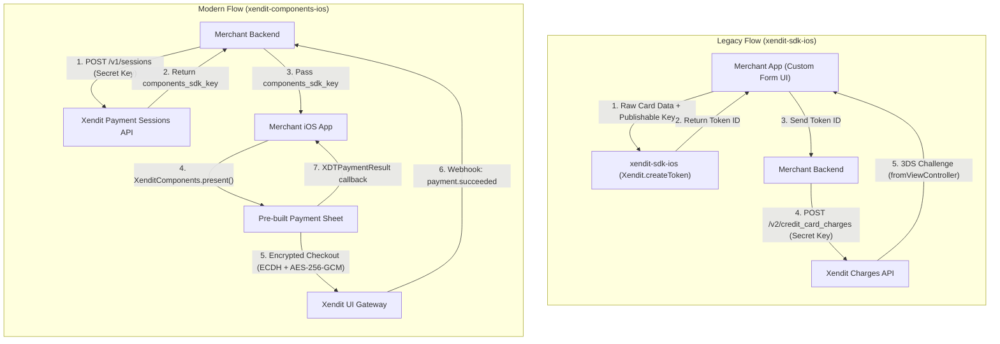

# Migration Guide: `xendit-sdk-ios` to `xendit-components-ios`

This guide helps you migrate your iOS application from the legacy Xendit iOS SDK ([`xendit-sdk-ios`](https://github.com/xendit/xendit-sdk-ios) / `xendit-sdk-ios-src` / `pod 'Xendit'`) to the modern **Xendit Components iOS SDK** ([`xendit-components-ios`](https://github.com/xendit/xendit-components-ios) / `XenditComponents`).

---

## Table of Contents
1. [Why Migrate to Components SDK?](#why-migrate-to-components-sdk)
2. [Key Architecture Differences](#key-architecture-differences)
3. [Prerequisites & Requirements](#prerequisites--requirements)
4. [Step-by-Step Migration](#step-by-step-migration)
   - [Step 1: Backend Session Creation](#step-1-backend-session-creation)
   - [Step 2: Update Package Dependencies](#step-2-update-package-dependencies)
   - [Step 3: Update SDK Initialization](#step-3-update-sdk-initialization)
   - [Step 4: Replace Payment UI & Tokenization Call](#step-4-replace-payment-ui--tokenization-call)
   - [Step 5: Appearance & Theming (Optional)](#step-5-appearance--theming-optional)
   - [Step 6: Payment Method Preference & Ordering (Optional)](#step-6-payment-method-preference--ordering-optional)
5. [Apple Pay Setup](#apple-pay-setup)
6. [Side-by-Side Code Comparisons](#side-by-side-code-comparisons)
   - [UIKit (Swift)](#uikit-swift-comparison)
   - [SwiftUI](#swiftui-comparison)
   - [Objective-C](#objective-c-comparison)
7. [FAQ & Troubleshooting](#faq--troubleshooting)

---

## Why Migrate to Components SDK?

| Capability | Legacy SDK (`xendit-sdk-ios`) | New SDK (`xendit-components-ios`) |
| :--- | :--- | :--- |
| **Payment Channels** | Credit/Debit Cards only | Cards, E-Wallets, QR Codes, Virtual Accounts, Bank Transfer, Direct Debit, OTC, **Apple Pay** |
| **User Interface** | None — Merchant builds custom UI fields | Drop-in full payment sheet with native SwiftUI & UIKit support |
| **Security Credential** | Static `publishableKey` in iOS app | Ephemeral, session-scoped `components_sdk_key` |
| **Data Encryption** | Standard HTTPS / Basic Tokenization | Client-side **ECDH + AES-256-GCM** payload encryption + TLS 1.2+ (ATS enforced) |
| **3DS & Redirects** | Manual `UIViewController` challenge handling | Automated in-sheet WebView & app-to-app redirect handling |
| **PCI-DSS Scope** | Typically **SAQ A-EP** (you host input fields) | Reduced to **SAQ A** (Xendit manages input fields) |

---

## Key Architecture Differences



---

## Prerequisites & Requirements

| Requirement | Legacy SDK | Components SDK |
| :--- | :--- | :--- |
| **Minimum iOS Version** | iOS 10.0+ | **iOS 15.0+** |
| **Xcode Version** | Xcode 11.0+ | **Xcode 14.0+** |
| **Swift Version** | Swift 5.0+ | **Swift 5.7+** |
| **Supported Frameworks** | UIKit | **SwiftUI & UIKit** (with Objective-C bridge) |

---

## Step-by-Step Migration

### Step 1: Backend Session Creation

The legacy SDK required a static public API key (`publishableKey`) configured directly in the app. The modern Components SDK uses an **ephemeral session key** (`components_sdk_key`) created by your backend.

1. On your backend, create a session via the [Xendit Payment Sessions API](https://developers.xendit.co):
   ```http
   POST https://api.xendit.co/sessions
   Authorization: Basic <BASE64_ENCODED_SECRET_KEY>
   Content-Type: application/json

   {
     "reference_id": "order-12345",
     "currency": "IDR",
     "amount": 100000,
     "customer": {
       "reference_id": "cust-001",
       "given_names": "Alex"
     }
   }
   ```
2. Retrieve the `components_sdk_key` from the response and send it to your iOS client:
   ```json
   {
     "id": "sess_12345",
     "components_sdk_key": "xnd_components_live_...",
     "status": "ACTIVE"
   }
   ```

---

### Step 2: Update Package Dependencies

#### A. Swift Package Manager (Recommended)

1. Remove the legacy `Xendit` dependency (`xendit-sdk-ios-src` or CocoaPods).
2. In Xcode, go to **File → Add Package Dependencies…**
3. Enter the repository URL:
   ```
   https://github.com/xendit/xendit-components-ios.git
   ```
4. Select **Up to Next Major Version** with `<latest_version>`.
5. Link `XenditComponents` to your target.

Alternatively, in your `Package.swift`:
```swift
dependencies: [
    .package(url: "https://github.com/xendit/xendit-components-ios.git", from: "<latest_version>")
]
```

#### B. CocoaPods (If Migrating Away from Podfile)

If you previously used CocoaPods (`pod 'Xendit'`):
1. Remove `pod 'Xendit'` from your `Podfile`.
2. Run `pod install` to clean up the legacy pod.
3. Add the package via Swift Package Manager as shown above.

---

### Step 3: Update SDK Initialization

#### Legacy (`xendit-sdk-ios`)
In the legacy SDK, you configured a static publishable key:
```swift
// Legacy
import Xendit

Xendit.publishableKey = "xnd_public_development_..."
```

#### Modern (`xendit-components-ios`)
Initialize `XenditComponents` once at app launch (e.g., in `AppDelegate` or SwiftUI `App.init()`). No publishable keys are passed to the client:

```swift
// Swift
import XenditComponents

XenditComponents.initialize(appearance: XenditAppearance())
```

```objc
// Objective-C
@import XenditComponents;

[XDTComponents initializeWithAppearance:[XDTAppearance new]];
```

---

### Step 4: Replace Payment UI & Tokenization Call

In the legacy SDK, you built custom text inputs for the card details, called `Xendit.createToken(...)`, and sent the resulting token ID to your backend.

With Components SDK:
1. **Remove** custom card input fields (`UITextField`s), CVV inputs, and custom form validation.
2. Call `XenditComponents.present(...)`, passing the `components_sdk_key` received from your backend.
3. Handle the result callback.

#### UIKit Example (Swift)
```swift
import UIKit
import XenditComponents

class CheckoutViewController: UIViewController {

    func presentPaymentSheet(componentsSdkKey: String) {
        XenditComponents.present(
            from: self,
            componentsSdkKey: componentsSdkKey
        ) { result in
            switch result {
            case .success(let paymentRequestId, let channelCode):
                print("Payment succeeded: \(paymentRequestId) via \(channelCode ?? "")")
            case .failed(let error):
                print("Payment failed: \(error.message)")
            case .canceled:
                print("Session canceled")
            case .expired:
                print("Session expired")
            case .dismissed:
                print("User dismissed the payment sheet")
            }
        }
    }
}
```

---

### Step 5: Appearance & Theming (Optional)

Match the payment sheet to your app brand using `XenditAppearance`:

```swift
import UIKit
import XenditComponents

let customAppearance = XenditAppearance(
    fontFamily: XenditFontFamily(
        regular:  UIFont(name: "Inter-Regular",  size: 16),
        medium:   UIFont(name: "Inter-Medium",   size: 16),
        semiBold: UIFont(name: "Inter-SemiBold", size: 16),
        bold:     UIFont(name: "Inter-Bold",     size: 16)
    ),
    colorPrimary:         UIColor.systemBlue,
    colorText:            UIColor.label,
    colorTextSecondary:   UIColor.secondaryLabel,
    colorBackground:      UIColor.systemBackground,
    borderRadius:         12
)

XenditComponents.initialize(appearance: customAppearance)
```

> **Note:** `XenditComponents.initialize(appearance:)` can be called multiple times at runtime to switch between themes (e.g., Light / Dark mode overrides).

---

### Step 6: Payment Method Preference & Ordering (Optional)

You can specify which payment methods to show and in what order by passing `merchantPreferredPaymentMethod`:

```swift
XenditComponents.present(
    from: self,
    componentsSdkKey: "<your_components_sdk_key>",
    merchantPreferredPaymentMethod: [.cards, .ewallet, .qrCode, .virtualAccount]
) { result in
    // handle result
}
```

Supported values include: `.cards`, `.ewallet`, `.qrCode`, `.virtualAccount`, `.bankTransfer`, `.directDebit`, and `.overTheCounter`.

---

## Apple Pay Setup

When Apple Pay is enabled in your backend session response, the SDK automatically presents the native Apple Pay button.

### Requirements:
1. **Apple Pay Entitlement:** In Xcode, select your app target → **Signing & Capabilities** → **+ Capability** → **Apple Pay**, and select your merchant ID.
2. **Merchant Identifier:** The merchant ID is configured on Xendit's backend and returned inside the session response. You do not need to pass it manually in `present(...)`.
3. The Apple Pay button appears automatically on physical devices with eligible cards enrolled in Wallet.

---

## Side-by-Side Code Comparisons

### UIKit (Swift) Comparison

#### Legacy (`xendit-sdk-ios`)
```swift
// Legacy: Manual card data extraction + tokenization
import Xendit

Xendit.publishableKey = "xnd_public_development_..."

let cardData = CardData()
cardData.cardNumber = cardNumberField.text
cardData.cardExpMonth = expMonthField.text
cardData.cardExpYear = expYearField.text
cardData.cardCvn = cvnField.text
cardData.isMultipleUse = false

Xendit.createToken(fromViewController: self, cardData: cardData, shouldAuthenticate: true) { token, error in
    if let error = error {
        self.showError(error.errorMessage)
    } else if let token = token {
        // Send token.id to backend to charge via /v2/credit_card_charges
        self.sendTokenToBackend(token.id)
    }
}
```

#### New (`xendit-components-ios`)
```swift
// Modern: Drop-in full payment sheet
import XenditComponents

XenditComponents.initialize(appearance: XenditAppearance())

XenditComponents.present(
    from: self,
    componentsSdkKey: "<your_components_sdk_key>"
) { result in
    switch result {
    case .success(let paymentRequestId, let channelCode):
        // Payment captured directly by Xendit!
        self.showSuccess(paymentRequestId)
    case .failed(let error):
        self.showError(error.message)
    case .canceled, .expired, .dismissed:
        break
    }
}
```

---

### SwiftUI Comparison

```swift
import SwiftUI
import XenditComponents

struct CheckoutView: View {
    @State private var componentsSdkKey = "<your_components_sdk_key>"

    var body: some View {
        Button("Pay with Xendit") {
            guard let rootVC = UIApplication.shared.connectedScenes
                .compactMap({ $0 as? UIWindowScene })
                .first?.windows.first?.rootViewController else { return }

            XenditComponents.initialize(appearance: XenditAppearance())
            XenditComponents.present(
                from: rootVC,
                componentsSdkKey: componentsSdkKey
            ) { result in
                switch result {
                case .success(let paymentRequestId, _):
                    print("Paid: \(paymentRequestId)")
                case .failed(let error):
                    print("Error: \(error.message)")
                case .canceled, .expired, .dismissed:
                    break
                }
            }
        }
    }
}
```

---

### Objective-C Comparison

#### Legacy (`xendit-sdk-ios`)
```objc
@import Xendit;

[Xendit setPublishableKey:@"xnd_public_development_..."];

XenditCardData *cardData = [XenditCardData new];
cardData.cardNumber = self.cardNumberTextField.text;
cardData.cardExpMonth = self.cardExpMonthTextField.text;
cardData.cardExpYear = self.cardExpYearTextField.text;
cardData.cardCvn = self.cardCvnTextField.text;

[Xendit createTokenFromViewController:self
                             cardData:cardData
                   shouldAuthenticate:YES
                           completion:^(XenditCCToken *token, XenditError *error) {
    if (error != nil) {
        NSLog(@"Error: %@", error.errorMessage);
    } else {
        [self sendTokenToBackend:token.id];
    }
}];
```

#### New (`xendit-components-ios`)
```objc
@import XenditComponents;

// 1. Initialize
XDTAppearance *appearance = [XDTAppearance new];
appearance.colorPrimary = UIColor.systemBlueColor;
appearance.borderRadius = 12;
[XDTComponents initializeWithAppearance:appearance];

// 2. Present payment sheet
[XDTComponents presentFromViewController:self
                       componentsSdkKey:@"<your_components_sdk_key>"
                               onResult:^(XDTPaymentResult *result) {
    switch (result.status) {
        case XDTPaymentStatusSuccess:
            NSLog(@"Payment succeeded: %@", result.paymentRequestId);
            break;
        case XDTPaymentStatusFailed:
            NSLog(@"Payment failed: %@", result.error.message);
            break;
        case XDTPaymentStatusCanceled:
            NSLog(@"Session canceled");
            break;
        case XDTPaymentStatusExpired:
            NSLog(@"Session expired");
            break;
        case XDTPaymentStatusDismissed:
            NSLog(@"User dismissed payment sheet");
            break;
    }
}];
```

---

## FAQ & Troubleshooting

### 1. Where do I get the `components_sdk_key`?
The `components_sdk_key` is created dynamically when your backend calls the [Xendit Payment Sessions API](https://docs.xendit.co/docs/components-overview) (`POST /v1/sessions`). It replaces the static publishable key used in the legacy SDK.

### 2. Can I still charge tokens manually on my backend?
With Components SDK, payment authorization and capture happen within the payment sheet flow. Your backend is notified of payment status via webhooks (`payment.succeeded`, `payment.failed`, `payment_session.completed`).

### 3. App Transport Security (ATS) Requirements
The SDK communicates over TLS 1.2+ with forward secrecy. **Do not** set `NSAllowsArbitraryLoads` to `true` or loosen TLS minimum versions for Xendit domains in your `Info.plist`.

### 4. How do I handle dark mode?
`XenditAppearance` supports dynamic `UIColor` values (e.g., `UIColor.systemBackground`, `UIColor.label`), which automatically adapt when iOS switches between light and dark modes.

### 5. Where can I find more sample code?
Check out the [Example/](Example/) directory in this repository for sample SwiftUI, UIKit, and Objective-C implementations.
